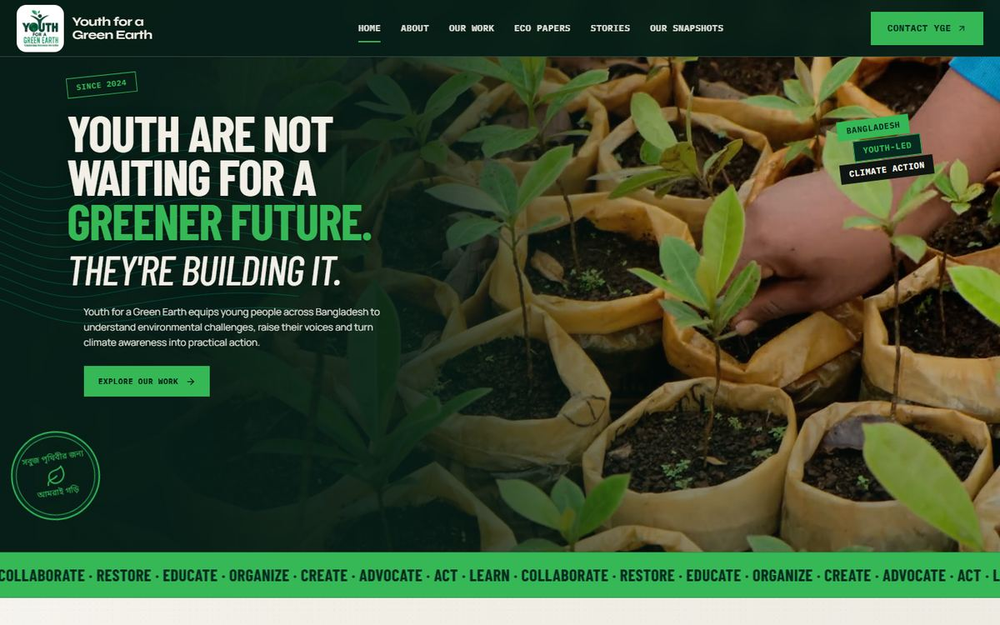
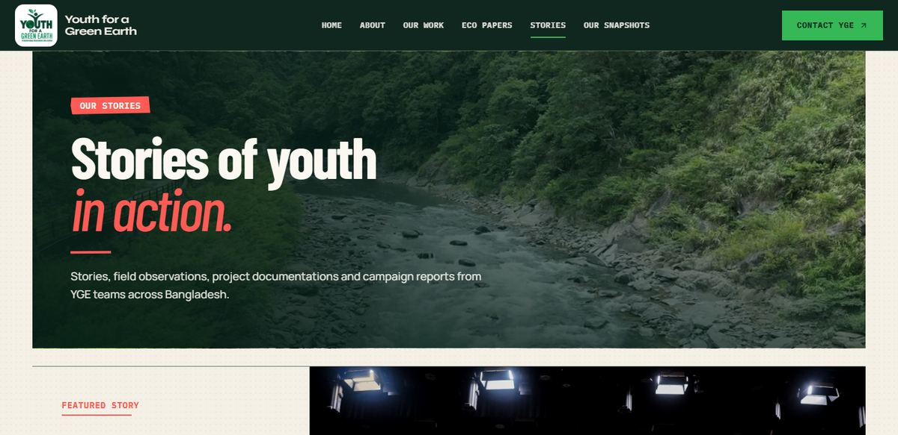
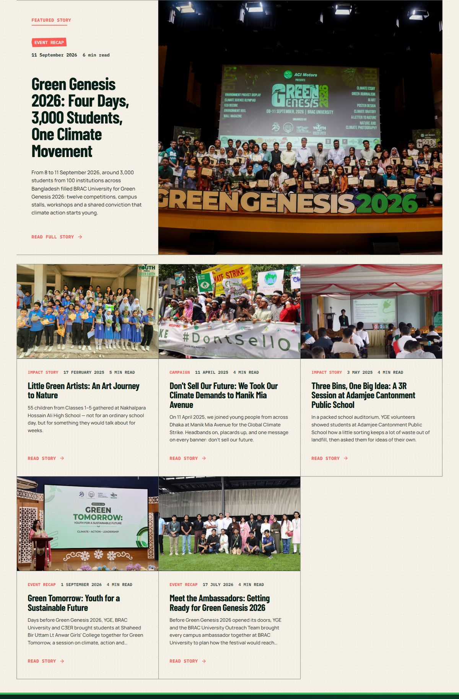
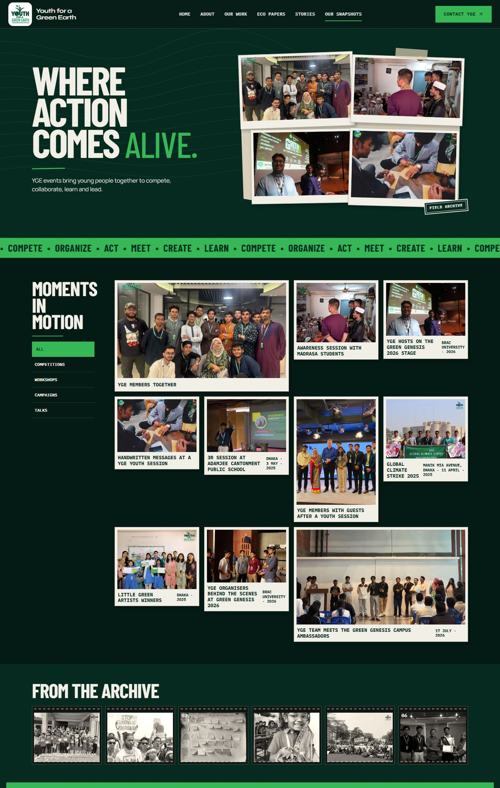
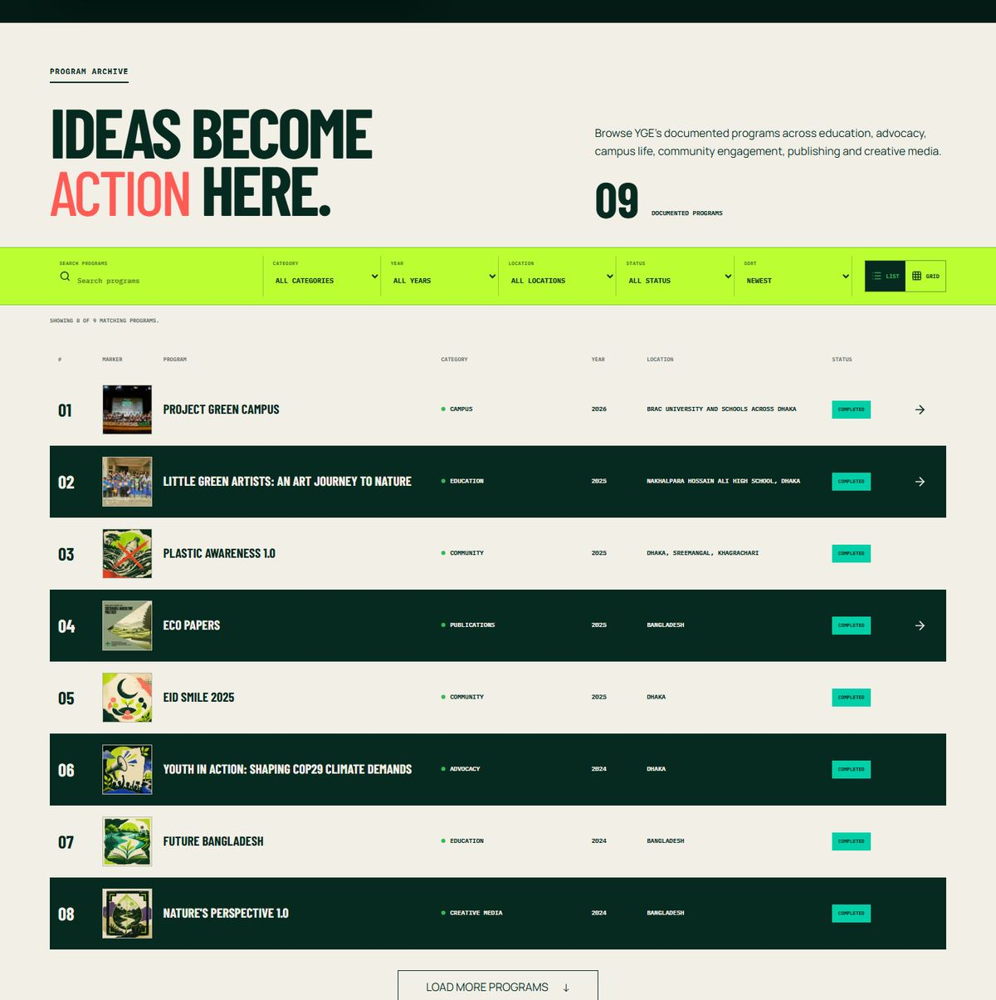
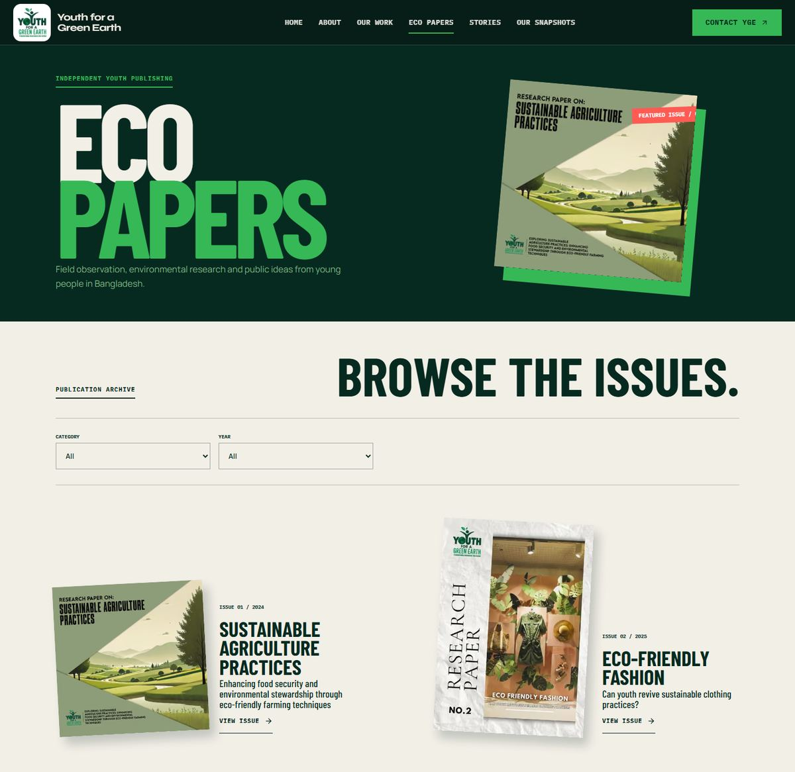
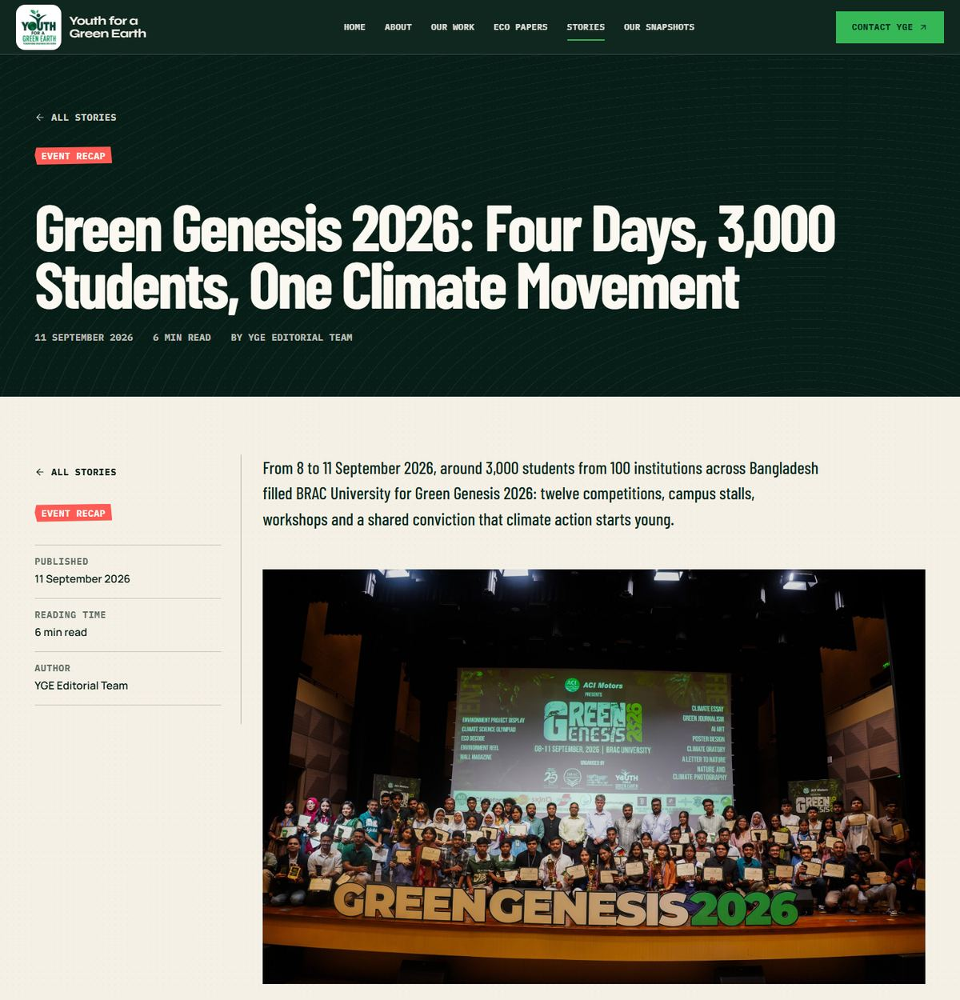
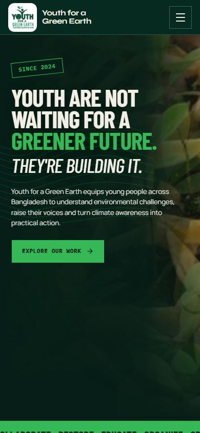

# Youth for a Green Earth — Website

**Transforming awareness into action.**

This is the official website of Youth for a Green Earth (YGE), a youth-led environmental organisation in Bangladesh. We use it to share what we do — school sessions, campaigns, Green Genesis, our Eco Papers — and to give people an easy way to reach us.

It's built with Next.js and keeps everything in typed content files, so updating a story or adding a programme is a code change, not a trip into a CMS.



---

## What's on the site

| Page              | What it's for                                                                                    |
| ----------------- | ------------------------------------------------------------------------------------------------ |
| **Home**          | Who we are, our work at a glance, the featured story and Eco Papers. Hero runs a looping video.  |
| **About**         | Our story, purpose and the way we work.                                                          |
| **Our Work**      | A searchable, filterable archive of every YGE programme, with Green Genesis 2026 up front.       |
| **Eco Papers**    | Our open-access publication series. Each paper opens straight in the browser's PDF viewer.       |
| **Stories**       | Write-ups from the field: Green Genesis, the Global Climate Strike, school sessions and more.    |
| **Our Snapshots** | Photos from YGE sessions, campaigns and member gatherings, plus a black-and-white archive strip. |
| **Contact**       | A secure contact form that lands in our inbox.                                                   |

<p>
  
</p>

<table>
  <tr>
    <td width="50%"></td>
    <td width="50%"></td>
  </tr>
  <tr>
    <td></td>
    <td></td>
  </tr>
  <tr>
    <td></td>
    <td align="center"></td>
  </tr>
</table>

---

## Built with

- **Next.js 16** (App Router) and **React 19**, written in **TypeScript**
- **Tailwind CSS 4** alongside a hand-built editorial stylesheet
- **shadcn/ui** components on **Radix UI** for the interactive bits — mobile menu, filter drawer, dropdowns, toggle filters and form fields — restyled to our own look (`src/components/ui`)
- **Framer Motion** for motion, **Lucide** for icons
- **Brevo** for email delivery and **Upstash Redis** for abuse protection on the contact form
- **Vitest**, **ESLint** and **Prettier**, all run in CI

## Getting started

You'll need **Node.js 22 LTS** (Next.js needs at least 20.9) and **npm 10+**. Use the version in `.nvmrc` when you can.

```bash
npm ci
npm run dev
```

Then open <http://localhost:3000>.

Only copy `.env.example` to `.env.local` if you're testing contact delivery. Local secrets are ignored by Git.

## Before you push

```bash
npm run check
```

This one command formats, lints, type-checks, runs the tests, audits production dependencies and does a production build. GitHub Actions runs exactly the same check on every push and pull request to `main`, so if it passes locally it should pass there.

Need just one step?

```bash
npm run format:check
npm run lint
npm run typecheck
npm run test
npm run audit
npm run build
```

---

## Keeping content up to date

Everything lives in `src/content/`. Edit the file, run `npm run check`, commit.

| To change…                                                          | Edit                            |
| ------------------------------------------------------------------- | ------------------------------- |
| Organisation details, social links, calls to action, featured event | `site.ts`                       |
| Stories (and which one is featured)                                 | `stories.ts`                    |
| Programmes on Our Work                                              | `programs.ts`                   |
| Events                                                              | `events.ts`                     |
| Our Snapshots gallery and archive strip                             | `event-gallery.ts`              |
| Eco Papers and resources                                            | `eco-papers.ts`, `resources.ts` |
| Navigation and footer links                                         | `navigation.ts`                 |
| Pages that are built but not public yet                             | `features.ts`                   |
| Shared image paths                                                  | `media.ts`                      |

### Stories

Each story in `stories.ts` has a body made of blocks: paragraphs, headings, quotes, lists and images.

- Give in-article photos a `width` and `height` so they keep their real shape instead of being cropped.
- A list with `variant: "placards"` renders as coral placard tags — great for slogans or segment names.
- Set `featured: true` on one story to put it at the top of the Stories page and on the homepage.

### Our Snapshots

Gallery photos are YGE's own sessions, campaigns and member gatherings. Keep partner-event photos to a minimum. The archive strip stays black and white on purpose; the gallery is full colour.

### Hidden pages

`features.ts` holds switches for pages that are ready but not public. The Team page is currently hidden: it returns a 404 and is left out of the navigation and sitemap. Set `teamPageLive: true` when the roster is ready.

### Team members

Team departments and profiles live in `src/content/team.ts`.

1. Add a verified photo under `public/images/team/` when you have one.
2. Add or update the member record.
3. Use a valid department ID and a unique order within that department.
4. Set `visible` explicitly and check the crop on phone and desktop.
5. Run `npm run check` before publishing.

Use a full public path for `photo`, or `null` for the initials fallback. Removing personal data from the current branch does not remove it from Git history — rewriting history is a separate, coordinated privacy job.

### Photos, video and PDFs

- **Photos** go in `public/images/`. Keep originals sharp: story photos are served exactly as saved, without extra compression, so don't re-save them at low quality. Around 1600–2400 px wide is plenty.
- **Videos** go in `public/videos/`. Hero videos are silent, short loops with a still poster frame. Keep a desktop version under about 5 MB and a phone version around 1 MB (H.264 MP4, no audio, `+faststart`). Visitors who prefer reduced motion see the poster instead.
- **PDFs** go in `public/pdfs/`. Leave the path out until the verified document exists.
- Always write accurate alt text, and only use images and footage we have the rights to. The homepage hero uses free stock footage from Pexels (ArtHouse Studio).

---

## Production setup

Set these encrypted environment variables in the hosting provider:

| Variable                                                | Purpose                                                                                        |
| ------------------------------------------------------- | ---------------------------------------------------------------------------------------------- |
| `NEXT_PUBLIC_SITE_URL`                                  | Canonical HTTPS origin                                                                         |
| `BREVO_API_KEY`                                         | Brevo transactional-email API key                                                              |
| `BREVO_SENDER_EMAIL`                                    | Verified Brevo sender address                                                                  |
| `BREVO_SENDER_NAME`                                     | Optional sender label                                                                          |
| `BREVO_RECIPIENT_EMAIL`                                 | Optional destination override                                                                  |
| `UPSTASH_REDIS_REST_URL`                                | Upstash Redis REST endpoint                                                                    |
| `UPSTASH_REDIS_REST_TOKEN`                              | Upstash Redis REST token                                                                       |
| `YGE_SECURITY_SECRET`                                   | At least 32 random server-only characters, used to HMAC identifiers and token keys             |
| `CONTACT_ALLOWED_ORIGINS`                               | Optional, exact comma-separated HTTPS staging origins (production apex and `www` are built in) |
| `CONTACT_GLOBAL_LIMIT`, `CONTACT_GLOBAL_WINDOW_SECONDS` | Optional global ceiling on successful deliveries; defaults to 100 per hour                     |

On Vercel, the app uses the platform-overwritten `x-forwarded-for` value. Behind a self-hosted reverse proxy, set `CONTACT_TRUST_PROXY_HEADERS=true` and `CONTACT_CLIENT_IP_HEADER=x-real-ip` only after Nginx overwrites that header, logs the verified address, and direct access to the Next.js origin is blocked.

The contact endpoint and token issuer **fail closed** in production if durable Redis or `YGE_SECURITY_SECRET` is missing. They never fall back to instance-local state in production. Local development and tests use an isolated in-memory adapter.

Deployment is managed outside this repository. Before announcing a release, check the canonical domain's DNS, TLS, environment settings, `/api/contact`, and every page on phone and desktop.

## How the contact form stays safe

We keep the form first-party and private — no CAPTCHA, no fingerprinting, no third-party bot detection. Instead it uses:

- strict Origin checks;
- an HttpOnly `SameSite=Strict` `__Host-` CSRF cookie with a matching header token;
- a 30-minute single-use form token and a two-second minimum completion time, checked on the server;
- an accessible off-screen trap field;
- atomic TTL rate limits and duplicate suppression;
- strict JSON and schema limits, and plain-text email delivery.

The page Content Security Policy uses a fresh nonce for Next.js hydration scripts and blocks inline script attributes. Nonces need request-time rendering, so pages are rendered dynamically instead of served as fully static HTML — we trade CDN-cacheable HTML and the lowest possible TTFB for a strict script policy. Inline style attributes are narrowly allowed because Framer Motion and some presentation components generate repository-controlled styles; submitted values never reach them.

This project targets Vercel/serverless, so Fail2ban isn't installed or claimed. On a future Linux/Nginx host, verify restored client IPs and the access-log format before adding tested Fail2ban filters; the app-level Redis controls stay mandatory.

---

## Project structure

```text
src/
├── app/             Routes, layouts, metadata and API handlers
├── components/      Page sections and shared components
│   └── ui/          shadcn/ui primitives, restyled for YGE
├── content/         Typed editorial content (stories, programmes, papers…)
├── lib/             Shared application and service logic
│   └── contact/     Contact validation, abuse controls and delivery
└── types/           Shared domain types

public/
├── images/          Photos, posters and artwork
├── videos/          Hero background loops
└── pdfs/            Eco Papers

docs/screenshots/    Images used in this README
```

Branded not-found and error pages use Next.js error boundaries directly, so the framework's HTTP status codes are preserved.

## Security

Found a vulnerability? Please report it privately — see [`SECURITY.md`](SECURITY.md). Never commit `.env` files, credentials, personal drafts, production exports or browser-profile data.

---

Made by young people in Bangladesh who'd rather build a greener future than wait for one. 🌱
